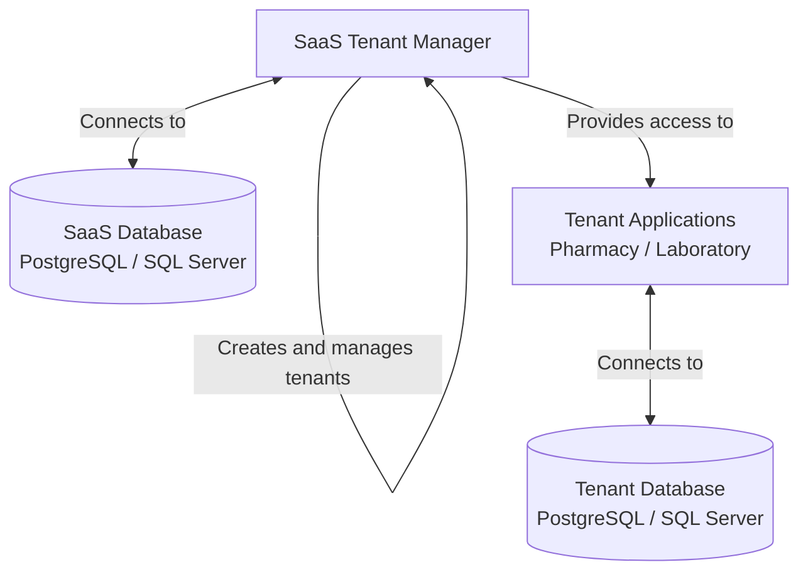

# SaaS — Multi-Tenant Application Platform

A multi-tenant application platform that enables multiple tenants to access and use different applications through a centralized tenant management system.

The platform consists of a **SaaS Tenant Manager** and tenant-aware applications such as **Pharmacy** and **Laboratory**. Each application maintains its own database and follows a consistent architectural pattern, with support for both PostgreSQL and Microsoft SQL Server.

## Table of Contents

- [Architecture](#architecture)
- [Application Ecosystem](#application-ecosystem)
- [Development Environment Setup](#development-environment-setup)
- [Managing Database Migrations](#managing-database-migrations)
  - [Prerequisites](#prerequisites)
  - [SaaS Project Migrations](#saas-project-migrations)
  - [Tenant Application Migrations](#tenant-application-migrations)
- [Running the Application](#running-the-application)
- [Author](#author)

## Architecture

The solution follows **Onion Architecture**, separating business logic, infrastructure concerns, and API endpoints into distinct projects.

Each application consists of the following projects:

| Project | Responsibility |
|---|---|
| `Core` | Contains the core business logic and domain models. |
| `Infrastructure` | Implements infrastructure concerns, including database access. |
| `Web` | Exposes application functionality through Web APIs. |

### Database Provider Support

Each application maintains separate migration projects for its supported database providers:

- **PostgreSQL:** `Infrastructure.PostGresMigration`
- **Microsoft SQL Server:** `Infrastructure.SqlServerMigration`

This separation allows each application to maintain database-specific migrations independently.

## Application Ecosystem

The platform uses a centralized tenant management application to create and manage tenants and direct them to the appropriate tenant-aware applications.



### How It Works

1. **Tenant management:** The SaaS application creates and manages tenant records.
2. **Centralized database:** The SaaS application uses its own database to store platform-level data.
3. **Tenant applications:** Applications such as Pharmacy and Laboratory provide tenant-specific functionality.
4. **Tenant databases:** Each tenant-aware application connects to its database using the configured database provider.
5. **Database flexibility:** Both the SaaS application and tenant applications support PostgreSQL and Microsoft SQL Server.

## Development Environment Setup

### 1. Configure the Database Provider

Configure the database provider and connection string in the `SaaS.Web` project's configuration file, such as `appsettings.json`.

#### Microsoft SQL Server

```json
{
  "DbProvider": "SqlServer",
  "ConnectionStrings": {
    "Default": "Server=localhost;Database=saasDb;Trusted_Connection=true;TrustServerCertificate=true;"
  }
}
```

#### PostgreSQL

```json
{
  "DbProvider": "PostGreSql",
  "ConnectionStrings": {
    "Default": "Server=127.0.0.1;Port=5432;Database=saasDb;User Id=<your-user>;Password=<your-password>;"
  }
}
```

Replace the example server details and credentials with values appropriate for your local environment.

> **Note:** Use the provider names expected by the application configuration. Keep actual credentials out of source control; use user secrets or environment variables for local development where appropriate.

### 2. Verify Your Environment

Before running the application, ensure that:

- The required .NET SDK is installed.
- The selected database server is running and accessible.
- The configured connection string points to the correct database.
- The appropriate database provider is selected.
- The necessary database migration projects are available.

## Managing Database Migrations

The solution maintains separate migration projects for SQL Server and PostgreSQL. Use the appropriate project and database provider when generating migrations.

### Prerequisites

Install the Entity Framework Core CLI tool globally if it is not already installed:

```bash
dotnet tool install --global dotnet-ef
```

If the tool is already installed, update it when necessary:

```bash
dotnet tool update --global dotnet-ef
```

### SaaS Project Migrations

Open a terminal in the `SAAS` directory before running the following commands.

#### Microsoft SQL Server

1. Configure the SQL Server connection string and provider in `SAAS.Web`.
2. Generate the migration:

```bash
dotnet ef migrations add "<migration-name>" \
  -s "SAAS.Web" \
  -p "SAAS.Infrastructure.SqlServer" \
  -- --dbProvider SqlServer
```

#### PostgreSQL

1. Configure the PostgreSQL connection string and provider in `SAAS.Web`.
2. Generate the migration:

```bash
dotnet ef migrations add "<migration-name>" \
  -s "SAAS.Web" \
  -p "SAAS.Infrastructure.PostGreSql" \
  -- --dbProvider PostGreSql
```

Replace `<migration-name>` with a descriptive name, such as `AddTenantConfiguration`.

### Tenant Application Migrations

The Pharmacy and Laboratory applications follow a similar migration workflow.

The following examples use the **Laboratory** application. Open a terminal in the `Laboratory` directory.

#### Microsoft SQL Server

```bash
dotnet ef migrations add "<migration-name>" \
  -s "Laboratory.Web" \
  -p "Laboratory.Infrastructure.SqlServerMigration" \
  -- "SqlServer" "<sql-connection-string>"
```

#### PostgreSQL

```bash
dotnet ef migrations add "<migration-name>" \
  -s "Laboratory.Web" \
  -p "Laboratory.Infrastructure.PostGresMigration" \
  -- "PostGreSql" "<postgres-connection-string>"
```

Replace the placeholders with the migration name and the appropriate database connection string.

Apply the same process to the Pharmacy application, using its corresponding startup and migration projects.

> **Important:** Generating a migration does not automatically apply it to the database. Use your application's database-update workflow to apply migrations when required.

## Running the Application

### 1. Configure Multiple Startup Projects

Configure your IDE or development environment to start multiple projects from the solution.

- **SaaS:** Must be started because it manages tenants.
- **Pharmacy:** Start when you need to work with Pharmacy APIs.
- **Laboratory:** Start when you need to work with Laboratory APIs.

Start the tenant-aware applications you need for your development or testing scenario.

### 2. Access Swagger UI

Each running Web API exposes a Swagger UI for exploring and testing its endpoints.

Use Swagger to inspect available APIs and execute requests during development.

### 3. Send Tenant Information in API Requests

Tenant-aware endpoints in the Pharmacy and Laboratory applications require a tenant identifier in the request headers.

Add the following header to your requests:

| Header | Value |
|---|---|
| `tenant` | The relevant `TenantId` |

For example:

```http
tenant: <TenantId>
```

Replace `<TenantId>` with a valid tenant identifier provided by the SaaS application.

Ensure that the tenant exists and that the application can resolve the corresponding tenant context before calling tenant-specific endpoints.

### 4. Test APIs with Postman

You can import the OpenAPI document exposed by Swagger into Postman to browse and test the APIs.

Remember to include the `tenant` header when calling tenant-aware endpoints.

## Author

**Sanjit Raj Shakya**

Website: [https://sanjitrajshakya.com.np](https://sanjitrajshakya.com.np)

---

Thank you for checking out this project!
